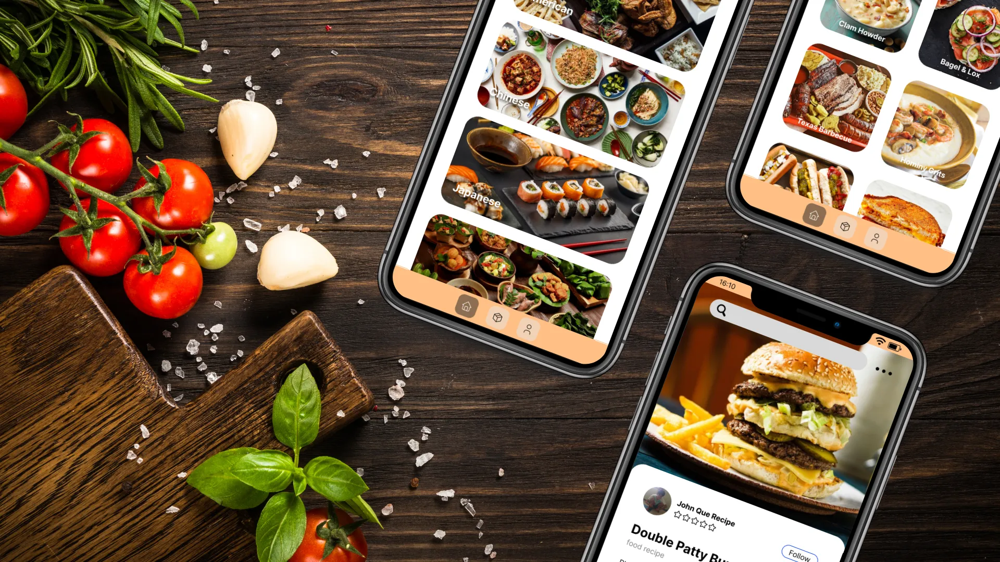
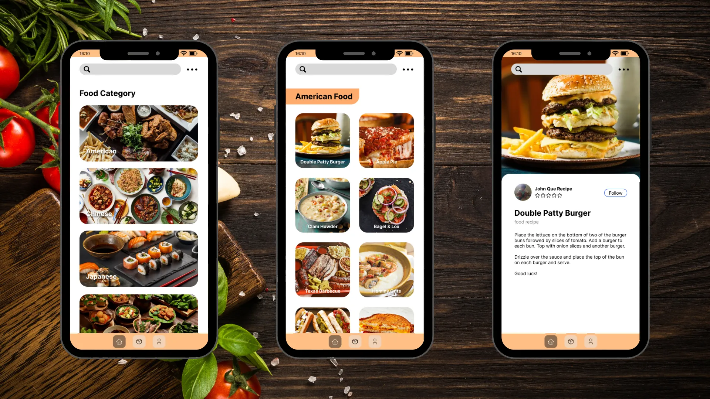

# Food Recipe Mobile App UIUX Design

## Project Overview

Food Recipe Mobile App UIUX Design is a mobile user interface design project created for a culinary recipe discovery and meal preparation application. The primary purpose of the design is to deliver an intuitive, visually appetizing mobile browsing experience that allows users to explore diverse culinary traditions, browse recipe collections categorized by cuisine, and follow clear, step-by-step cooking instructions on handheld mobile devices.

## Problem Statement & Objectives

Finding and preparing home-cooked meals often presents challenges for mobile users navigating cluttered layouts, hard-to-read ingredient lists, and complex multi-step cooking instructions. The design challenge addressed by this project is structuring a seamless mobile interface that simplifies recipe exploration and cooking guidance through clean visual hierarchy and focused culinary imagery.

The design objectives include:
- Designing a clear category navigation hierarchy to help users discover culinary dishes across multiple global cuisines (such as American, Chinese, and Japanese).
- Establishing a clean two-column grid layout for browsing recipe cards featuring high-resolution food photography and dish names.
- Structuring a dedicated recipe detail view highlighting the dish title, creator attribution, rating metrics, follow functionality, and step-by-step preparation instructions.
- Delivering a consistent mobile navigation system with persistent search access and bottom tab navigation for core user workflows.

## Project Type & Design Approach

This project focuses on visual interface design for a mobile culinary application, emphasizing content discoverability, appetizing visual presentation, and readability during kitchen preparation. The design approach relies on clean card-based layouts, warm accent tones, and clear typography tailored for handheld mobile interactions.

| Attribute | Description |
| --- | --- |
| Project Type | Mobile App Design |
| Supporting Discipline | UI Design |
| Design Approach | Card-Based Visual Interface Design |
| Target Platform | Mobile (iOS) |
| Primary Tool | Not Specified |
| Main Deliverable | Mobile UI Screens (WebP Previews) |

## Target Audience & User Needs

The intended target audience consists of home cooks, culinary enthusiasts, and everyday mobile users seeking straightforward recipe ideas and cooking instructions on their handheld devices. While formal demographic research or validated user research data was not conducted for this repository, the visual interface directly addresses the practical functional needs of mobile culinary browsing.

- **Cuisine Discovery**: Browsing dishes by global cuisine categories to quickly find meal inspiration.
- **Recipe Browsing**: Scanning recipe collections through high-contrast visual cards with clear dish titles.
- **Instructional Readability**: Reviewing step-by-step cooking directions and preparation tips without visual clutter.
- **Creator Connection**: Viewing recipe author details and ratings to evaluate trusted culinary contributors.
- **Streamlined Navigation**: Accessing search and main application sections through persistent navigation controls.

## Design Scope & Deliverables

The scope of this design project encompasses high-fidelity mobile application interface screens covering core culinary browsing and recipe detail flows. All completed visual deliverables are exported and preserved as high-resolution WebP artifacts within the repository.

| Deliverable | Description | Status / Location |
| --- | --- | --- |
| Project Banner Mockup | Perspective three-device presentation mockup showcasing core app screens on a culinary cutting board background | Completed / [screenshot/banner.webp](screenshot/banner.webp) |
| Food Category Screen | High-fidelity screen displaying searchable global cuisine category cards (American, Chinese, Japanese) with bottom navigation | Completed / [screenshot/image1.webp](screenshot/image1.webp) |
| Category Recipe Grid Screen | High-fidelity screen showing two-column recipe grid for American Food (Double Patty Burger, Apple Pie, Clam Chowder, etc.) | Completed / [screenshot/image1.webp](screenshot/image1.webp) |
| Recipe Detail Screen | High-fidelity screen featuring hero dish imagery, creator profile, rating, follow action, and step-by-step cooking instructions | Completed / [screenshot/image1.webp](screenshot/image1.webp) |

## Design Solution & Key Features

The design solution establishes a warm, appetizing visual environment utilizing warm peach accent colors, high-contrast typography, and generous imagery that elevates recipe content. By structuring the user flow from high-level cuisine categories down to individual recipe steps, the interface ensures intuitive navigation and effortless comprehension.

- **Global Cuisine Categorization**: Large visual category cards representing international cuisines (e.g., American, Chinese, Japanese) for instant recognition and discovery.
- **Two-Column Recipe Grid**: Structured grid layout with rounded image cards, clear dish labels, and comfortable spacing for efficient scanning.
- **Recipe Hero Header**: Prominent full-width culinary photography showcasing the prepared dish at the top of the detail screen.
- **Creator Attribution & Social Elements**: Dedicated author card displaying the chef's avatar, name ("John Que Recipe"), star rating, and a follow action button.
- **Step-by-Step Cooking Guidance**: Clear instructional copy structured sequentially to assist users through meal preparation.
- **Persistent Header Search & Options**: Search bar with search icon and contextual action trigger (`...`) accessible across screens.
- **Curved Bottom Navigation Bar**: Fixed three-icon navigation dock (Home/Explore, Saved Collections, User Profile) styled with a warm background container and active tab indicators.

## Design Workflow

Based on the repository artifacts and exported deliverables, the project followed a visual UI design and presentation workflow:

1. **Interface Concept & Layout Definition**: Defining core mobile screens for category discovery, recipe listings, and detailed cooking instructions.
2. **Visual Styling & Component Styling**: Applying warm color accents, rounded card containers, typography hierarchy, and culinary photography assets.
3. **Screen Composition & Screen Flow Assembly**: Designing high-fidelity mobile screens ([screenshot/image1.webp](screenshot/image1.webp)) depicting the user path from category selection to recipe preparation.
4. **Presentation Mockup Rendering**: Composing a multi-device perspective presentation mockup set against a themed culinary background ([screenshot/banner.webp](screenshot/banner.webp)) for portfolio and repository presentation.

*(Note: Earlier exploratory sketches, wireframes, or user testing records were not included in the repository; the workflow reflects the completed visual design deliverables present.)*

## Design Tools & Tech Stack

| Category | Tool / Technology | Purpose |
| --- | --- | --- |
| Asset Format | WebP | Optimized, lightweight image format for high-fidelity interface previews and banners |
| Platform Target | iOS Mobile Interface | Target operating system standards and status bar ergonomics for screen designs |
| Repository Management | Git / GitHub | Version control and public project presentation |

## Design Preview

The following gallery presents the exported high-fidelity mobile interface designs, showcasing the category exploration view, cuisine recipe collection grid, and detailed recipe preparation view.

## Contributing

Contributions, feedback, and suggestions for improving the design system and screen layouts are welcome. To contribute to this project, please follow these steps:

1. Fork the repository.
2. Create a branch for the change.
3. Make the changes.
4. Check that relevant design files, assets, and documentation are organized correctly.
5. Commit and push the branch.
6. Open a pull request with a clear explanation and relevant previews when applicable.

## License

This project is licensed under the MIT License.
See the [LICENSE](LICENSE) file for details.

## Author & Contact

**Yohanes Dimas Pratama**

- GitHub: [github.com/weztcy](https://github.com/weztcy)
- Portfolio: [yohanesdimas.com](https://yohanesdimas.com)
- LinkedIn: [linkedin.com/in/yohanes-dimas](https://www.linkedin.com/in/yohanes-dimas)
