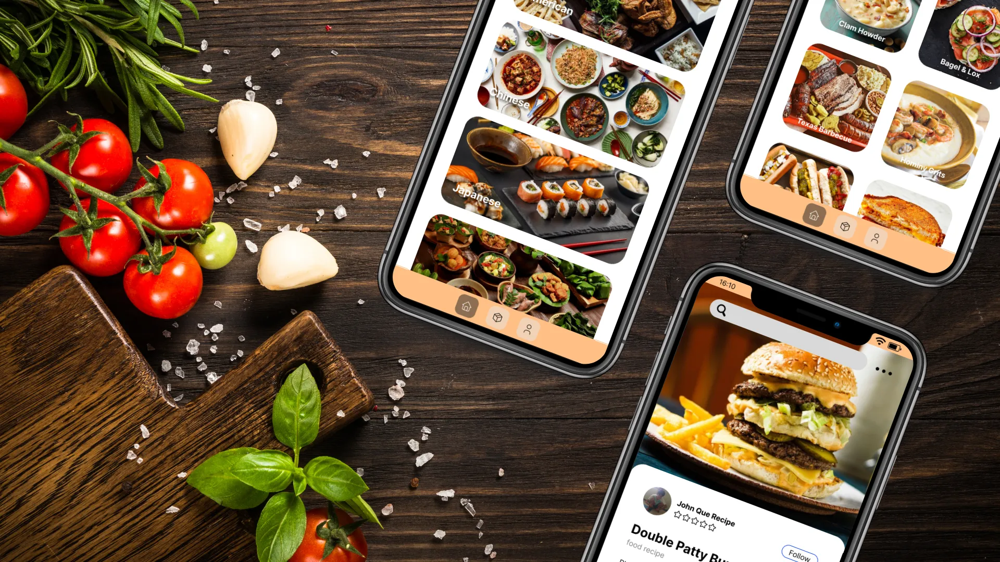
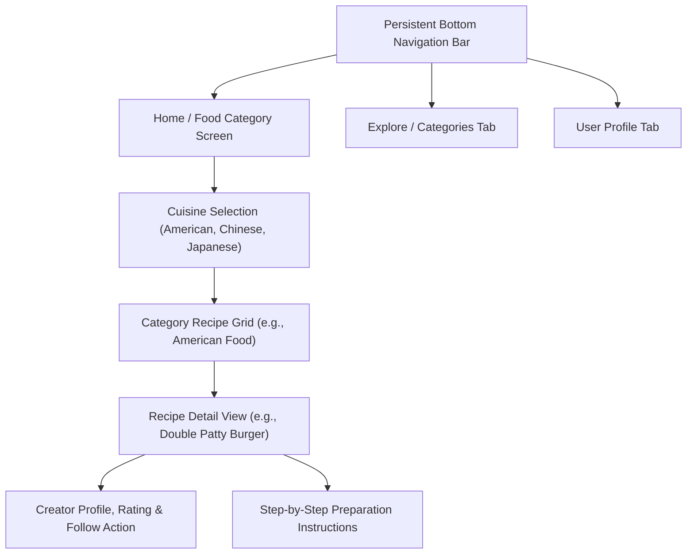
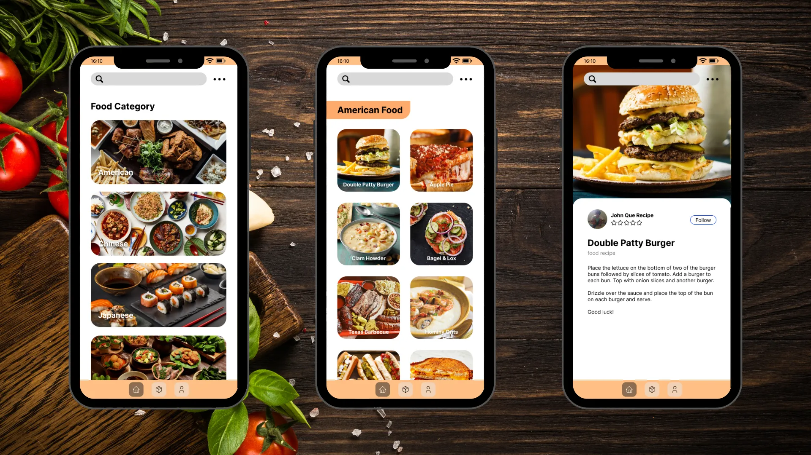

# Food Recipe Mobile App UIUX Design

## Project Overview

Food Recipe Mobile App UIUX Design is a 2021 mobile application interface and user experience concept focused on intuitive culinary discovery and distraction-free recipe reading. Designed around a warm apricot and high-contrast white visual language, the concept organizes dishes by cuisine category, visual recipe grids, and creator-attributed preparation steps inside a streamlined three-screen mobile flow.

## Problem Statement & Objectives

Many mobile recipe applications overwhelm home cooks with cluttered text, intrusive overlays, and multi-layered menus before a user can even start preparing a meal. This design project aims to simplify recipe exploration from initial cuisine selection down to readable cooking instructions.

- Establish a clear three-tier browsing hierarchy from global cuisine categories to individual dish instructions.
- Prioritize appetizing food photography as the primary visual anchor across category cards, dish grids, and recipe headers.
- Maintain persistent top search access and a lightweight three-tab bottom navigation bar for effortless one-handed mobile browsing.
- Present creator attribution, community ratings, and concise preparation steps cleanly on the recipe detail screen.

## Project Type & Design Approach

The project is an exploratory high-fidelity Mobile App UI/UX Design concept emphasizing visual clarity, scannable culinary photography, and minimal navigation friction across core discovery and reading screens.

| Attribute | Description |
| :--- | :--- |
| Project Type | Mobile App Design |
| Supporting Discipline | Visual Interface Design & Information Architecture |
| Design Approach | User-Centered Visual Hierarchy |
| Target Platform | Mobile (iOS & Android) |
| Primary Tool | Figma |
| Main Deliverable | High-Fidelity Mobile UI Mockups (`WebP`) |

## Target Audience & User Needs

The interface is intended for everyday home cooks, busy students, and food enthusiasts looking to browse cuisines quickly and follow straightforward meal preparation steps on a smartphone. Because no formal field surveys or usability testing logs are included in this repository, validated user research metrics were not established; the design instead addresses core usability expectations observed in mobile culinary browsing.

- **Casual Home Cooks**: Need rapid visual scanning of familiar cuisines such as American, Chinese, and Japanese dishes without deep menu nesting.
- **Quick-Meal Planners**: Require a persistent search bar and scannable two-column dish cards to compare meal ideas at a glance.
- **Step-by-Step Readers**: Benefit from clean white reading surfaces, short instruction paragraphs, and visible recipe author attribution with follow controls.

## Design Scope & Deliverables

This repository preserves the exported high-fidelity presentation assets and licensing metadata for the mobile recipe app concept. Source `.fig` project files, clickable prototype links, and external research documents are not stored in this repository.

| Deliverable | Description | Status / Location |
| :--- | :--- | :--- |
| Hero Presentation Mockup | Angled multi-device showcase highlighting the category, grid, and recipe screens | Completed ([screenshots/banner.webp](screenshots/banner.webp)) |
| 3-Screen Core Flow Showcase | Side-by-side high-fidelity mobile UI walkthrough across all three primary views | Completed ([screenshots/image1.webp](screenshots/image1.webp)) |
| Open-Source License | Repository licensing terms | Completed ([LICENSE](LICENSE)) |

## Information Architecture & Sitemap

The application structure follows a shallow, predictable three-level flow anchored by a persistent top search bar and a fixed three-tab bottom navigation bar (`Home`, `Categories / Explore`, and `Profile`).

## Design Solution & Key Features

The visual solution pairs warm apricot accents (`#FFBF85` and `#FEAB6C`) with crisp white surfaces (`#FFFFFF`) so high-resolution food photography stands out without sacrificing text legibility. Consistent header and footer framing anchors users across every screen transition.

- **Persistent Top Search & Action Header**: Every screen keeps a rounded neutral search bar (`#D9D9D9`) and overflow menu (`...`) accessible beneath the mobile status bar.
- **Full-Width Cuisine Category Cards**: The landing feed highlights regional cuisines (`American`, `Chinese`, `Japanese`) with rounded photography cards and crisp white bottom-left typography.
- **Two-Column Dish Grid**: Selecting a category opens a tagged section banner (`American Food`) above a balanced two-column grid showcasing dishes like `Double Patty Burger`, `Apple Pie`, `Clam Howder`, `Bagel & Lox`, `Texas Barbecue`, and `Hominy Grits`.
- **Creator-Attributed Recipe Detail Card**: Opening a dish displays a full-bleed hero meal photo above a white content sheet containing the creator's avatar (`John Que Recipe`), five-star rating indicators, a cobalt-outlined `Follow` button (`#2B4590`), and concise preparation copy.
- **Warm Three-Tab Bottom Navigation**: A unified `#FFBF85` navigation bar houses `Home`, `Explore`, and `Profile` icons, with the active tab distinguished by a warm taupe indicator (`#886D52`).

## Design Workflow

Based on the artifacts preserved in this repository, the design workflow focused directly on high-fidelity mobile interface composition and realistic device presentation:

1. **Navigation & Flow Definition**: Structured the core culinary journey into three sequential mobile views (`Food Category` → `Category Dish Grid` → `Recipe Detail`) linked by a shared header and three-tab bottom bar.
2. **Visual System & Color Styling**: Paired warm apricot navigation chrome (`#FFBF85` / `#FEAB6C`) with `#FFFFFF` content sheets, `#D9D9D9` input fields, and high-contrast `#000000` headings to keep food photography central.
3. **High-Fidelity Screen Composition**: Designed the full-width cuisine cards, two-column dish grid, and creator-attributed recipe detail layout within iOS-proportioned mobile frames.
4. **Device Mockup Presentation**: Staged the finalized screens inside perspective and side-by-side smartphone frames over a natural culinary backdrop and exported them as WebP assets in [screenshots/](screenshots/).

## Design Tools & Tech Stack

| Category | Tool / Technology | Purpose |
| :--- | :--- | :--- |
| UI/UX Design | Figma | High-fidelity mobile screen layout, typography, and component composition |
| Asset Export | WebP | Optimized high-resolution presentation mockups for repository previews |

## Design Preview

### 1. Core Recipe Discovery & Preparation Flow

This three-screen showcase illustrates the complete mobile user journey from browsing full-width cuisine cards on the `Food Category` feed, filtering into the two-column `American Food` dish grid, and opening the `Double Patty Burger` detail view. Across all three frames, a persistent search pill and warm apricot three-tab bottom navigation bar maintain spatial orientation while high-contrast white cards keep creator attribution, `Follow` actions, and cooking instructions immediately scannable.

## Contributing

Contributions to refine the visual assets, expand screen states, or improve documentation are welcome through standard pull requests.

1. Fork the repository.
2. Create a branch for the change.
3. Make the changes.
4. Check that relevant design files, assets, and documentation are organized correctly.
5. Commit and push the branch.
6. Open a pull request with a clear explanation and relevant previews when applicable.

## License

This project is licensed under the MIT License.
See the [LICENSE](LICENSE) file for details.

## Author & Contact

**Yohanes Dimas Pratama**

- GitHub: [github.com/weztcy](https://github.com/weztcy)
- Portfolio: [yohanesdimas.com](https://yohanesdimas.com)
- LinkedIn: [linkedin.com/in/yohanes-dimas](https://www.linkedin.com/in/yohanes-dimas)
