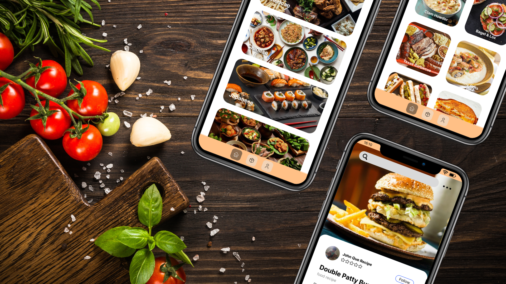
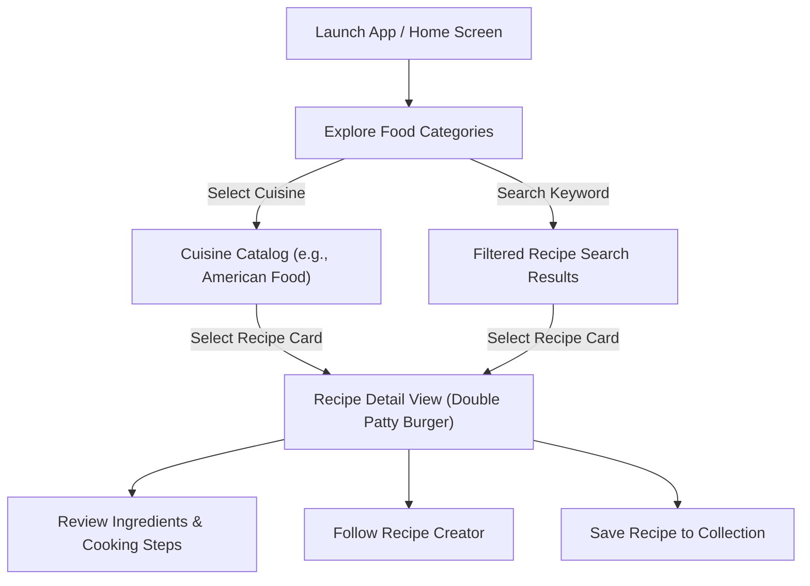

# Food Recipe Mobile App UI/UX Design

## Project Description

**Food Recipe Mobile App** is a high-fidelity mobile application UI/UX concept designed to simplify recipe discovery, culinary inspiration, and step-by-step home cooking. The design provides home chefs and cooking enthusiasts with an intuitive, visually appetizing interface that organizes recipes across international cuisines, showcases curated recipe catalogs, and provides clear, distraction-free preparation instructions.

This repository features high-fidelity interface screen designs, component layouts, and presentation mockups tailored for modern mobile form factors.

---

## Project Overview

Cooking apps often overwhelm users with cluttered layouts, intrusive advertisements, or convoluted recipe navigation. The **Food Recipe Mobile App** addresses these usability challenges by prioritizing visual appetite appeal, clean content hierarchy, and ergonomic navigation.

The design encompasses three core user experience touchpoints:
1. **Cuisine & Category Exploration**: Direct access to diverse culinary traditions through prominent visual cards.
2. **Curated Recipe Catalog**: A structured grid view displaying available recipes with high-impact imagery and clear dish nomenclature.
3. **Step-by-Step Cooking Guide**: An uncluttered recipe detail sheet presenting creator attribution, community ratings, and concise preparation instructions.

*Note: This repository contains high-fidelity UI/UX design deliverables, screen mockups, and visual assets; it does not contain a functional software or backend codebase.*

---

## Problem Statement & Design Goals

### Problem Statement
- **Information Overload**: Many culinary platforms bury essential preparation steps underneath lengthy introductory narratives and unstructured content.
- **Friction in Meal Discovery**: Users searching for culinary inspiration often struggle when recipes are not organized logically by regional cuisines or clear categories.
- **In-Kitchen Readability**: Reviewing small text and crowded layouts on a mobile screen while preparing food leads to user frustration and mistakes.

### Design Goals
- **Appetite-First Visual Hierarchy**: Utilize high-contrast, professional food photography to make meal selection engaging and immediate.
- **Categorical Clarity**: Structure navigation into distinct cuisine groupings (e.g., American, Chinese, Japanese) to accelerate discovery.
- **Glanceable Preparation Instructions**: Present cooking steps in clean, legible typography with ample whitespace for hands-on kitchen usability.
- **Creator Connection**: Highlight recipe authors and ratings to build community credibility and culinary trust.

---

## Target Users & User Needs

### User Personas
- **The Home Cook**: Seeks quick inspiration for weeknight dinners and wants clear, step-by-step guidance without unnecessary fluff.
- **The Culinary Explorer**: Enjoys discovering authentic international cuisines and browsing diverse dishes by regional origin.
- **The Novice Baker / Cook**: Requires digestible, easy-to-follow directions and visual cues to build confidence in the kitchen.

### Core User Needs
- Fast, accessible category filtering from the primary interface.
- Instant visual confirmation of finished dishes through high-quality photography.
- Concise ingredient handling and cooking instructions readable at arm's length.
- Persistent bottom navigation for rapid switching between discovery, collections, and user preferences.

---

## Design Goals & Key Features

### 1. Global Cuisine Discovery
- **Top Search & Action Bar**: Dedicated search input paired with a contextual options menu for quick filtering.
- **Visual Category Cards**: Full-width cards featuring representative photography and bold typographic labels for global cuisines, including American, Chinese, Japanese, and Southeast Asian traditions.

### 2. Category Recipe Catalog (American Food)
- **Active Filter Tag**: Visual badge header indicating the currently selected category (`American Food`) in an appetizing warm peach tone.
- **Two-Column Recipe Grid**: Balanced card layout showcasing popular dishes (e.g., Double Patty Burger, Apple Pie, Clam Chowder, Bagel & Lox, Texas Barbecue, Hominy Grits).
- **Subtle Scrim Overlays**: Semi-transparent dark bottom scrims ensuring consistent text legibility over varied culinary imagery.

### 3. Recipe Detail & Cooking Guide
- **Immersive Hero Showcase**: Large-scale hero photography highlighting the completed dish.
- **Author Attribution & Community Proof**: Creator profile badge displaying chef name (`John Que Recipe`), avatar, community rating indicator, and a dedicated **Follow** button.
- **Sequential Preparation Steps**: Numbered, formatted cooking instructions written in clear, concise language to facilitate kitchen execution.

### 4. Ergonomic Navigation Architecture
- **Persistent Bottom Navigation Bar**: Floating tab container with dedicated icons for Home, Recipe Collection/Box, and User Profile.
- **Thumb-Zone Optimization**: Core interactive elements positioned within natural thumb reach for one-handed mobile use.

---

## Design Preview & Showcase

The interface showcase highlights the seamless transition from high-level culinary discovery to detailed step-by-step recipe preparation:

*Figure 1: High-fidelity screen designs showcasing (Left) Food Category Explorer, (Center) American Cuisine Recipe Grid, and (Right) Recipe Detail & Preparation View.*

---

## UX Research & Insights

The user experience strategy for the **Food Recipe Mobile App** is informed by standard culinary mobile usability principles:

- **Cognitive Load Reduction**: Users preparing food have divided attention. Presenting cooking instructions in brief sentences rather than dense paragraphs reduces errors during food preparation.
- **Visual Association**: Visual recognition precedes text processing; pairing high-resolution dish photography with prominent titles enables rapid scanning and appetite stimulation.
- **One-Handed Ergonomics**: In kitchen environments, users often hold utensils or ingredients with one hand. Placing key navigation anchors at the bottom edge ensures comfortable one-handed navigation.

---

## User Flow & Information Architecture

### User Journey Flow

### Information Architecture

- **Home / Categories**:
  - Global Search Bar & Settings Menu
  - Featured Culinary Categories (American, Chinese, Japanese, Regional)
- **Cuisine Catalog**:
  - Active Category Identifier
  - Multi-Column Dish Grid (Dish Name, Image Thumbnail)
- **Recipe Detail**:
  - Full-Width Hero Presentation
  - Creator Profile & Rating Summary
  - Dish Name & Subtitle
  - Cooking Preparation Directions
- **Global Navigation**:
  - Home (Category Explorer)
  - Recipe Collection (Saved & Favorited Dishes)
  - User Profile (Preferences, Following, Account Settings)

---

## Wireframes & Prototypes

- **Design Fidelity**: High-Fidelity Mockups & UI Layouts.
- **Status**: The interface screens have been designed and rendered to production fidelity, establishing the color palette, typography hierarchy, iconography, and spatial relationships.
- **Deliverable Format**: High-resolution screen captures and composited presentation mockups available in the repository.

---

## UI Design & Screens

### 1. Category Discovery Screen
The opening view welcomes users with an accessible search bar and a curated list of international cuisines. Full-bleed cards with rounded corners create visual rhythm and provide clear touch targets for selecting desired food styles.

### 2. Cuisine Catalog Screen
Upon selecting a cuisine (e.g., "American Food"), the user enters a catalog view organized into a clean 2-column grid. Each recipe card features rounded borders, vibrant photography, and dark translucent text scrims for optimal contrast.

### 3. Recipe Detail & Cooking Guide
The detail screen utilizes a curved bottom-sheet motif overlapping the hero photography. The recipe header prominently highlights author credentials ("John Que Recipe"), community star ratings, and an actionable "Follow" button, followed by clear cooking steps.

---

## Design System & Components

### Color Palette
- **Warm Peach Accent** (`#FDBA74` / `#FED7AA`): Primary accent color used for category badges, active navigation indicators, and warm culinary highlights.
- **Clean Surface White** (`#FFFFFF`): Primary background and card surface color, delivering high contrast and visual cleanliness.
- **Input Background Neutral** (`#E5E7EB` / `#F3F4F6`): Subtle light grey utilized for search fields and inactive containers.
- **Deep Slate / Charcoal Typography** (`#111827` / `#1F2937`): Primary text color ensuring maximum readability and accessibility against light surfaces.

### Typography
- **Heading Styles**: Bold, modern geometric sans-serif for screen titles, category cards, and dish names.
- **Body & Instruction Text**: Medium/Regular weights optimized for legible reading on high-density mobile screens.
- **Subtitles & Metadata**: Muted grey tones for secondary information (e.g., "food recipe" classification).

### UI Components
- **Search Pill**: Rounded search bar with integrated leading magnifying glass icon and trailing options trigger.
- **Category Pill Tag**: Rounded highlight tag establishing context within specific culinary categories.
- **Recipe Cards**: Balanced rectangular cards with rounded corners and bottom overlay text labels.
- **Author Badge**: Compact horizontal component pairing a circular creator avatar, author name, rating stars, and outline action button.
- **Bottom Navigation Bar**: Persistent, rounded bottom bar with intuitive outline icons (Home, Collection, Profile).

---

## Responsive Design & Platform Support

- **Target Platform**: Mobile Smartphones (iOS / Android).
- **Screen Ratio**: Optimized for modern mobile displays with edge-to-edge screens, top camera cutouts/notches, and gesture navigation bars.
- **Touch Targets**: All primary interactive elements (cards, buttons, navigation tabs) adhere to standard minimum touch target guidelines (44x44 pt).

---

## Design Tools & Assets

- **Design Tooling**: Modern vector UI/UX design software (Figma).
- **Visual Assets**:
  - High-resolution food photography sourced and curated for culinary categorization.
  - Minimalist outline vector iconography for navigation, search, and creator interactions.
- **Deliverable Exports**: PNG image formats rendered at high resolution for presentations and portfolio showcases.

---

## Design Deliverables

The repository includes the following design deliverables:
- **Presentation Hero Banner**: `./screenshots/banner.png` — Angled 3-phone presentation mockup on a culinary background.
- **Screen Flow Showcase**: `./screenshots/Food Recipe Mobile App UI_UX Design 1.png` — Three-screen linear flow showcasing the Category Explorer, Recipe Catalog, and Recipe Detail View.

---

## How to View & Use Design Files

- All showcase images and visual designs are rendered in high-resolution PNG format and can be directly viewed within this repository on GitHub.
- For design inspection or portfolio inclusion, open the image files located in the `screenshots/` directory using any standard image viewer or web browser.

---

## License

Please see the [LICENSE](./LICENSE) file for the terms and conditions governing the use, modification, and distribution of this project.

## Author & Contact

**Yohanes Dimas Pratama**

- GitHub: [github.com/weztcy](https://github.com/weztcy)
- Portfolio: [dimaspratama.vercel.app](https://dimaspratama.vercel.app)
- LinkedIn: [linkedin.com/in/yohanes-dimas](https://www.linkedin.com/in/yohanes-dimas)
